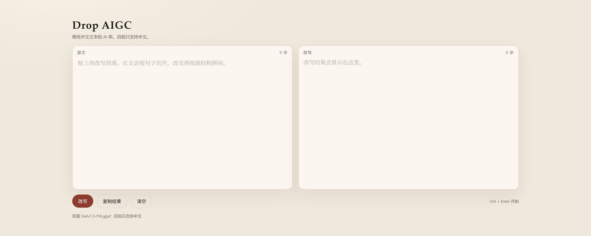

# Drop AIGC

降低中文文本 AI 率的本地改写工具。将中文学术句子改写成更接近人工撰写的表述，保留术语、数字与原意。

目前只支持中文。



## 模型

权重在 Hugging Face（GGUF F16，约 3.1 GB）：

https://huggingface.co/k86574/Drop-AIGC

```bash
hf download k86574/Drop-AIGC Dailv1.5-f16.gguf --local-dir models
```

下载后的文件应位于 `models/Dailv1.5-f16.gguf`。放在其他位置时，将 `DAILV15_MODEL` 设为完整路径。

## 环境

| 项目 | 要求 |
| --- | --- |
| 系统 | Windows、Linux 或 macOS |
| Python | 3.10 及以上 |
| 推理 | [llama.cpp](https://github.com/ggml-org/llama.cpp) 的 `llama-cli`。已有 `llama-server` 时可复用，见下方 |
| 显卡 | 可选。有显卡时由 llama.cpp 自行选择设备 |
| 磁盘 | 模型约 3.1 GB |

```bash
python -m venv .venv
.venv\Scripts\activate
pip install -r requirements.txt
```

Linux 与 macOS 将激活命令换成 `source .venv/bin/activate`。

## 目录

```
app/server.py      页面服务
app/index.html     页面
app/dailv.py       改写实现
models/            放置 Dailv1.5-f16.gguf
requirements.txt   运行依赖
```

## 启动

```bash
python app/server.py
```

在浏览器打开 http://127.0.0.1:8780 。

若本机已经用 llama.cpp 起好推理服务，可在启动页面前指定地址，页面会直接复用，不再单独加载权重：

```bash
set DAILV_SERVER=http://127.0.0.1:8080
python app/server.py
```

自行启动推理服务的示例（端口与设备按本机情况修改）：

```bash
llama-server -m models/Dailv1.5-f16.gguf --host 127.0.0.1 --port 8080 -c 1024
```

# 更新一代：Dailv

改写质量更好、速度更快。工具已开源；模型需在 Hugging Face 申请访问后下载。

https://github.com/k856487/Dailv
